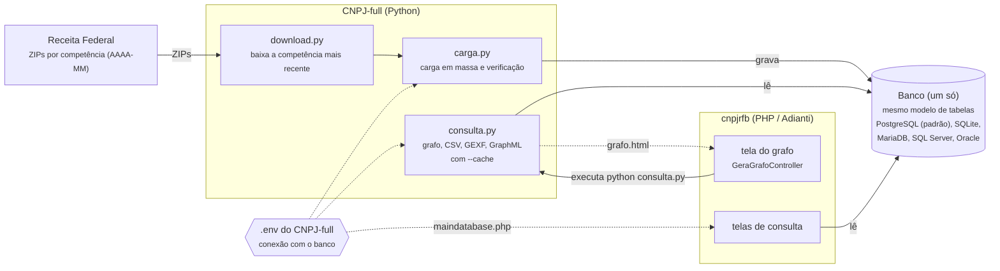

[← Voltar ao README](../README.md) | [Sumário da documentação](sumario.md)

# Arquitetura: cnpjrfb + CNPJ-full

> [!NOTE]
> Este documento descreve a **proposta** de unificação dos dois projetos. Partes dela ainda não estão implementadas; a seção [O que já existe e o que falta](#o-que-já-existe-e-o-que-falta) mostra o estado atual.

Os dois projetos continuam separados, cada um com um papel:

* **[CNPJ-full](https://github.com/bjverde/CNPJ-full) (Python)**: é o único que **escreve** no banco. Baixa os arquivos da Receita Federal, faz a carga em massa e gera o grafo de relacionamentos.
* **cnpjrfb (PHP)**: é só a interface web. **Lê** o mesmo banco e pede o grafo ao CNPJ-full.



Fluxo:

1. O `download.py` baixa os ZIPs da competência mais recente da Receita.
2. O `carga.py` grava no banco escolhido, com o mesmo modelo de [`docs/modelo_banco/`](modelo_banco.md).
3. As telas do cnpjrfb e o `consulta.py` leem **o mesmo banco**: não há um SQLite separado só para o grafo.
4. A tela do grafo chama o `consulta.py` (configurado na seção `'cnpj_full'` do `app/config/application.php`) e mostra o `grafo.html` gerado.

---

## Conexão única: o PHP lendo o `.env` do Python

A conexão fica num lugar só: o arquivo `.env` na raiz do CNPJ-full (`app/CNPJ-full/.env`). O Python já lê esse arquivo, e o `app/config/maindatabase.php` lê o **mesmo** arquivo, para nunca haver duas cópias da senha do banco.

### Por que o PHP consegue ler

O `.env` não é um formato do Python: é um arquivo de texto com uma variável por linha, no formato `CHAVE=valor`, e linhas começando com `#` são comentários. Qualquer linguagem lê isso.

```ini
CNPJ_DB_TIPO=postgres
CNPJ_DB_HOST=localhost
CNPJ_DB_PORTA=5432
CNPJ_DB_NOME=dados_rfb
CNPJ_DB_USUARIO=postgres
CNPJ_DB_SENHA=troque_esta_senha
CNPJ_DB_SCHEMA=dados_rfb
```

Os nomes são os do [`.env.example` do CNPJ-full](https://github.com/bjverde/CNPJ-full/blob/master/.env.example).

> [!WARNING]
> **Não use `parse_ini_file()`** para ler esse `.env`. Ele falha com o `.env.example` do CNPJ-full (`syntax error, unexpected '"'`), porque os comentários com `#` e aspas não são INI válido no PHP 7+. A classe `ConfigCnpjFullPython` lê o arquivo linha a linha.

### Onde o PHP procura o `.env`

O `app/config/maindatabase.php` só tem uma linha, `return ConfigCnpjFullPython::getConfigBanco();`. Toda a lógica fica na classe `app/control/maindatabase/controllers/ConfigCnpjFullPython.class.php`, que usa a pasta do CNPJ-full informada em `app/config/application.php`:

```php
'cnpj_full' => [
    'path' => 'app/CNPJ-full',   // relativo à pasta www/cnpjrfb, ou absoluto (ex.: D:/cnpj/CNPJ-full)
    ...
],
```

e lê o `.env` da raiz dessa pasta (`<path>/.env`), o mesmo arquivo que o Python usa. É o mesmo `path` que a tela do grafo usa para chamar o `consulta.py`, então **um único lugar** diz onde está o CNPJ-full e, com ele, a conexão com o banco.

* **Sem `.env`**: o sistema mostra o erro (exceção do `ConfigCnpjFullPython::verificarEnv()`) com o caminho onde o arquivo era esperado. O `.env` é obrigatório.
* **Usar o SQLite que vem no cnpjrfb**: no `.env`, `CNPJ_DB_TIPO=sqlite` e `CNPJ_DB_ARQUIVO=../database/cnpjrfb.db` (relativo a `app/CNPJ-full`).
* **`CNPJ_DB_TIPO=postgres`** (ou `mysql`, `sqlserver`, `oracle`): usa `CNPJ_DB_HOST`, `CNPJ_DB_PORTA`, `CNPJ_DB_NOME`, `CNPJ_DB_USUARIO` e `CNPJ_DB_SENHA`. O tipo é convertido para o nome do Adianti (`postgres` → `pgsql`, `sqlserver` → `sqlsrv`).
* **SQLite com `CNPJ_DB_ARQUIVO`**: caminho relativo à pasta do CNPJ-full (igual ao Python) ou absoluto. Sem `CNPJ_DB_TIPO`, vale `sqlite`. Tipo inválido ou SQLite sem `CNPJ_DB_ARQUIVO` também geram exceção.

Métodos da classe:

| Método | O que faz |
| --- | --- |
| `getPathCnpjFull()` | pasta do CNPJ-full (`application.php` > `cnpj_full` > `path`) |
| `getPathEnv()` | caminho do `.env` |
| `verificarEnv()` | lança exceção se o `.env` não existe |
| `getVariaveis()` | array com todas as variáveis de banco (`CNPJ_DB_TIPO`, `HOST`, `PORTA`, `NOME`, `USUARIO`, `SENHA`, `SCHEMA`, `ARQUIVO`), sempre com todas as chaves |
| `getConfigBanco()` | array de conexão no formato do Adianti, usado pelo `maindatabase.php` |

Nenhum arquivo novo nem renomeado em `app/config`: só o conteúdo do `maindatabase.php` mudou. O `getConfigBanco()` também cria o `.htaccess` com `Require all denied` na pasta do CNPJ-full, se ainda não existir, porque o `.env` tem a senha do banco.

Pontos de atenção:

* **SQLite**: o `.env.example` do CNPJ-full já vem com `CNPJ_DB_ARQUIVO=dados/teste/cnpj_teste.db` (banco de teste com dados fictícios). Se o `.env` for só uma cópia do exemplo, as telas também passam a usar esse banco de teste; para usar a base real, ajuste `CNPJ_DB_ARQUIVO` ou o bloco do PostgreSQL.
* **Schema**: a carga grava no schema `CNPJ_DB_SCHEMA` (padrão `dados_rfb`). O `getConfigBanco()` não usa essa variável (ela vem em `getVariaveis()`): informe o schema em `www/cnpjrfb/init.php` (`DATABASE_SCHEMA`), como em [Instalação](instalacao.md#3-configurar-o-banco).
* **Docker**: o container PHP e o do PostgreSQL ficam na mesma rede; em `CNPJ_DB_HOST` vai o nome do serviço (`database` no `docker-compose.yml` deste projeto), não `localhost`.
* **Segurança**: o `.env` tem a senha do banco. A pasta do CNPJ-full recebe um `.htaccess` com `Require all denied` (criado pelo `ConfigCnpjFullPython` e pelo `GeraGrafoController`), então o Apache não serve o arquivo. Num servidor que não seja Apache, bloqueie a pasta na configuração dele.
* **Grafo**: o `consulta.py` ainda só lê SQLite (`CNPJ_DB_ARQUIVO`). Com `CNPJ_DB_TIPO=postgres`, as telas leem o PostgreSQL, mas o grafo continua no SQLite até o CNPJ-full ler do PostgreSQL.

---

## O que já existe e o que falta

| Parte | Situação |
| --- | --- |
| Download da Receita (`download.py`) | pronto no CNPJ-full |
| Carga no PostgreSQL e no SQLite (`carga.py`) | pronto no CNPJ-full |
| Carga em MariaDB, SQL Server e Oracle | planejado |
| `consulta.py` lendo do PostgreSQL | **falta**: hoje o grafo só lê SQLite |
| Tela do grafo chamando o CNPJ-full em `app/CNPJ-full` | pronto (configurado no `application.php`) |
| `maindatabase.php` lendo o `.env` da pasta do CNPJ-full (`ConfigCnpjFullPython`) | pronto |
| Telas que usam a conexão `cnpj_full` passarem a usar `maindatabase` | **falta** |
| Script `atualizar` (baixa, carrega, verifica e troca a base) | planejado |
