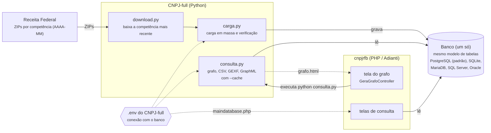

[← Voltar ao README](../README.md) | [Sumário da documentação](sumario.md)

# Arquitetura: cnpjrfb + CNPJ-full

> [!NOTE]
> Este documento descreve a **proposta** de unificação dos dois projetos. Partes dela ainda não estão implementadas; a seção [O que já existe e o que falta](#o-que-já-existe-e-o-que-falta) mostra o estado atual.

Os dois projetos continuam separados, cada um com um papel:

* **[CNPJ-full](https://github.com/bjverde/CNPJ-full) (Python)**: é o único que **escreve** no banco. Baixa os arquivos da Receita Federal, faz a carga em massa e gera o grafo de relacionamentos.
* **cnpjrfb (PHP)**: é só a interface web. **Lê** o mesmo banco e pede o grafo ao CNPJ-full.



Fluxo:

1. O `download.py` baixa os ZIPs da competência mais recente da Receita.
2. O `carga.py` grava no banco escolhido, com o mesmo modelo de [`docs/modelo_banco/`](modelo_banco.md).
3. As telas do cnpjrfb e o `consulta.py` leem **o mesmo banco**: não há um SQLite separado só para o grafo.
4. A tela do grafo chama o `consulta.py` (configurado na seção `'cnpj_full'` do `app/config/application.php`) e mostra o `grafo.html` gerado.

---

## Conexão única: o PHP lendo o `.env` do Python

A conexão fica num lugar só: o arquivo `.env` na raiz do CNPJ-full (`app/CNPJ-full/.env`). O Python já lê esse arquivo; a proposta é o `app/config/maindatabase.php` ler o **mesmo** arquivo, para nunca haver duas cópias da senha do banco.

### Por que o PHP consegue ler

O `.env` não é um formato do Python: é um arquivo de texto com uma variável por linha, no formato `CHAVE=valor`, e linhas começando com `#` são comentários. Qualquer linguagem lê isso.

```ini
CNPJ_DB_TIPO=postgres
CNPJ_DB_HOST=localhost
CNPJ_DB_PORTA=5432
CNPJ_DB_NOME=dados_rfb
CNPJ_DB_USUARIO=postgres
CNPJ_DB_SENHA=troque_esta_senha
CNPJ_DB_SCHEMA=dados_rfb
```

Os nomes são os do [`.env.example` do CNPJ-full](https://github.com/bjverde/CNPJ-full/blob/master/.env.example).

> [!WARNING]
> **Não use `parse_ini_file()`** para ler esse `.env`. Ele falha com o `.env.example` do CNPJ-full (`syntax error, unexpected '"'`), porque os comentários com `#` e aspas não são INI válido no PHP 7+. Use a função `lerEnv()` abaixo, que lê linha a linha.

### Ordem de leitura

Igual à do CNPJ-full:

1. **Variável de ambiente** (`getenv()`): no Docker, vem do `env_file` ou `environment` do `docker-compose.yml`.
2. **Arquivo `.env`**: o caminho vem de `CNPJ_ENV`; sem ela, `app/CNPJ-full/.env`.
3. **Padrão**: o SQLite que já vem no cnpjrfb (`app/database/cnpjrfb.db`).

### Como ficaria o `app/config/maindatabase.php`

Nenhum arquivo novo nem renomeado em `app/config`: só o conteúdo do `maindatabase.php` muda. O Adianti aceita qualquer código PHP nesse arquivo, desde que ele devolva o array da conexão.

```php
<?php
// Conexão lida do .env do CNPJ-full (docs/arquitetura.md).
// Ordem: variável de ambiente > .env > SQLite padrão do cnpjrfb.

if (!function_exists('cnpjLerEnv')) {
    function cnpjLerEnv(string $arquivo): array
    {
        $env = [];
        if (!is_file($arquivo)) {
            return $env;
        }
        foreach (file($arquivo, FILE_IGNORE_NEW_LINES | FILE_SKIP_EMPTY_LINES) as $linha) {
            $linha = trim($linha);
            if ($linha === '' || $linha[0] === '#' || strpos($linha, '=') === false) {
                continue;
            }
            [$chave, $valor] = array_map('trim', explode('=', $linha, 2));
            $aspas = $valor[0] ?? '';
            if (strlen($valor) > 1 && ($aspas === '"' || $aspas === "'") && substr($valor, -1) === $aspas) {
                $valor = substr($valor, 1, -1);
            }
            $env[$chave] = $valor;
        }
        return $env;
    }
}

$pastaCnpjFull = __DIR__.'/../CNPJ-full';
$env = cnpjLerEnv(getenv('CNPJ_ENV') ?: $pastaCnpjFull.'/.env');
$valor = function (string $chave, string $padrao = '') use ($env): string {
    $v = getenv($chave);
    if ($v !== false && $v !== '') {
        return $v;
    }
    return $env[$chave] ?? $padrao;
};

// CNPJ_DB_TIPO (nomes do CNPJ-full) -> type do Adianti
$tipos = ['postgres' => 'pgsql', 'mysql' => 'mysql', 'sqlserver' => 'sqlsrv', 'oracle' => 'oracle', 'sqlite' => 'sqlite'];
$tipo  = $valor('CNPJ_DB_TIPO', 'sqlite');

if ($tipo === 'sqlite') {
    // CNPJ_DB_ARQUIVO é relativo à raiz do CNPJ-full; sem ele, o banco do cnpjrfb
    $arquivo = $valor('CNPJ_DB_ARQUIVO');
    $nome = 'app/database/cnpjrfb.db';
    if ($arquivo !== '') {
        $absoluto = preg_match('#^([a-zA-Z]:)?[\\\\/]#', $arquivo) === 1;
        $nome = $absoluto ? $arquivo : $pastaCnpjFull.'/'.$arquivo;
    }
    return ['name' => $nome, 'type' => 'sqlite', 'prep' => '1', 'slog' => 'SystemSqlLogService'];
}

return [
     'host' => $valor('CNPJ_DB_HOST')
    ,'port' => $valor('CNPJ_DB_PORTA')
    ,'name' => $valor('CNPJ_DB_NOME')
    ,'user' => $valor('CNPJ_DB_USUARIO')
    ,'pass' => $valor('CNPJ_DB_SENHA')
    ,'type' => $tipos[$tipo] ?? $tipo
    ,'prep' => '1'
    ,'slog' => 'SystemSqlLogService'
];
```

Pontos de atenção:

* **SQLite**: o `.env.example` do CNPJ-full já vem com `CNPJ_DB_ARQUIVO=dados/teste/cnpj_teste.db` (banco de teste com dados fictícios). Se o `.env` for só uma cópia do exemplo, as telas também passam a usar esse banco de teste; para usar a base real, ajuste `CNPJ_DB_ARQUIVO` ou o bloco do PostgreSQL.
* **Schema do PostgreSQL**: a carga grava no schema `CNPJ_DB_SCHEMA` (padrão `dados_rfb`). Para as telas acharem as tabelas sem prefixo, o usuário do banco precisa desse schema no `search_path` (`ALTER ROLE <usuario> SET search_path = dados_rfb, public;`).
* **Docker**: o container PHP e o do PostgreSQL ficam na mesma rede; em `CNPJ_DB_HOST` vai o nome do serviço (`database` no `docker-compose.yml` deste projeto), não `localhost`.
* **Segurança**: o `.env` tem a senha do banco. A pasta `app/CNPJ-full` recebe um `.htaccess` com `Require all denied` (feito pelo `GeraGrafoController`), então o Apache não serve o arquivo.

---

## O que já existe e o que falta

| Parte | Situação |
| --- | --- |
| Download da Receita (`download.py`) | pronto no CNPJ-full |
| Carga no PostgreSQL e no SQLite (`carga.py`) | pronto no CNPJ-full |
| Carga em MariaDB, SQL Server e Oracle | planejado |
| `consulta.py` lendo do PostgreSQL | **falta**: hoje o grafo só lê SQLite |
| Tela do grafo chamando o CNPJ-full em `app/CNPJ-full` | pronto (configurado no `application.php`) |
| `maindatabase.php` lendo o `.env` | **proposta** (código acima) |
| Telas que usam a conexão `cnpj_full` passarem a usar `maindatabase` | **falta** |
| Script `atualizar` (baixa, carrega, verifica e troca a base) | planejado |
